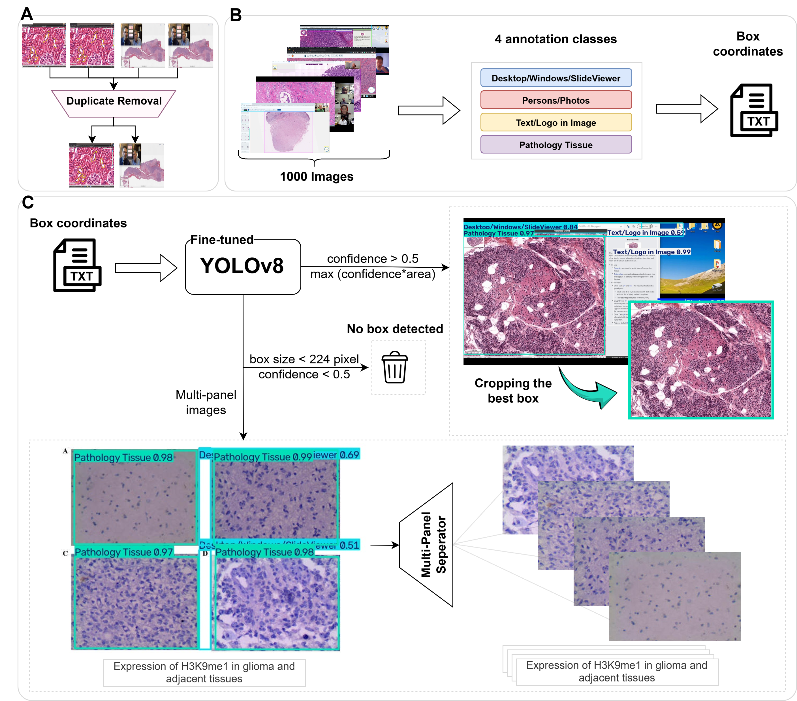
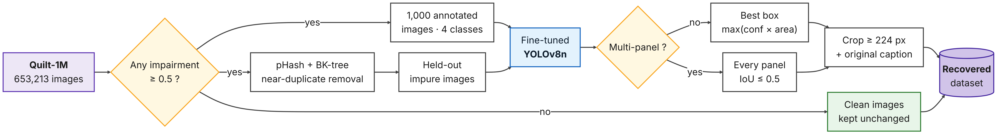
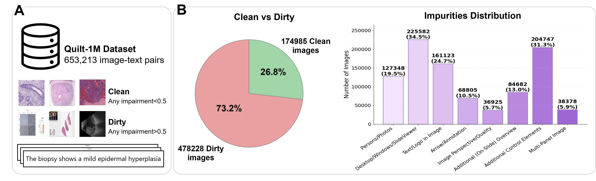

<div align="center">

# 🔬 ReQuilt

### A Region-Level Cleaning Pipeline for Quilt-1M Histopathology Image–Text Dataset

*Keep the tissue in impure images instead of throwing the whole image away.*

[](#-citation)
[](https://www.python.org/)
[](https://github.com/ultralytics/ultralytics)
[](https://quilt1m.github.io/)
[](LICENSE)

**Sana Radman · Hasti Shabani**<br>
Faculty of Electrical Engineering · Institute of Medical Science and Technology<br>
Shahid Beheshti University, Tehran, Iran

[Overview](#-overview) · [Results](#-results) · [Pipeline](#-pipeline) · [Quick start](#-quick-start) · [Repository](#-repository-layout) · [Citation](#-citation)

</div>

---

## ✨ Overview

[Quilt-1M](https://quilt1m.github.io/) is one of the largest publicly available vision–language datasets for histopathology, with **653,213 images** paired with captions. Because its images come from heterogeneous online sources, many of them also contain **persons, slide-viewer interfaces, text overlays and multi-panel layouts**. **73.2 %** of the images are classified as impure.

Existing cleaning strategies operate **at the image level** and discard an entire image when an impurity is detected, even when tissue regions may remain recoverable. **ReQuilt operates at the region level:** a four-class YOLOv8 detector distinguishes pathology tissue from three common
surrounding impurity types, and the pipeline **crops the tissue** and pairs each crop with the original caption.

<div align="center">

| | Image-level filtering | **ReQuilt (region-level)** |
|---|:-:|:-:|
| Impure image with a recoverable tissue region | ❌ discarded | ✅ tissue cropped & kept |
| Multi-panel image | ❌ discarded | ✅ one crop per panel |
| Surrounding impurity types | — | ✅ 3 explicit impurity classes |
| Localization against ground-truth annotations | — | ✅ mean IoU 0.899 |

</div>

---

## 📊 Results

<table>
<tr>
<td align="center" width="25%"><h2>92.0 %</h2>impure images with ≥ 1 candidate tissue region detected<br><sub>(1,000 held-out images)</sub></td>
<td align="center" width="25%"><h2>98.8 %</h2>recovered crops free of residual impurities<br><sub>(manual inspection)</sub></td>
<td align="center" width="25%"><h2>0.949</h2>tissue mAP@0.5<br><sub>(150-image validation split)</sub></td>
<td align="center" width="25%"><h2>0.899</h2>mean IoU of matched tissue boxes<br><sub>(strict: 0.824)</sub></td>
</tr>
</table>

### Detector: fine-tuned YOLOv8n (validation split, Table I of the paper)

| Class | Images | Instances | Precision | Recall | mAP@0.5 | mAP@0.5:0.95 |
|---|--:|--:|--:|--:|--:|--:|
| Persons/Photos | 37 | 48 | 0.806 | 0.750 | 0.831 | 0.731 |
| Desktop/Slide-viewer | 97 | 282 | 0.764 | 0.766 | 0.821 | 0.593 |
| Text/Logo in Image | 56 | 127 | 0.850 | 0.654 | 0.779 | 0.468 |
| **Pathology Tissue** | **143** | **180** | **0.911** | **0.928** | **0.949** | **0.781** |
| *Impurity classes (mean)* | 190 | 457 | 0.807 | 0.723 | 0.810 | 0.597 |

> Recovery is evaluated on 1,000 held-out impure images; the detector on the 150-image validation split.

---

## 🗒 Pipeline

<div align="center">

<br>
<sub><b>(A)</b> near-duplicate removal · <b>(B)</b> four-class manual annotation · <b>(C)</b> detection, single-panel best-box cropping and multi-panel decomposition</sub>
</div>

<br><br>

<div align="center">

<br>
<sub><b>ReQuilt Flowchart</b></sub>
</div>
<br><br>
<b>Each step of the paper maps to one notebook:</b>
<br><br>

| # | Notebook | Paper | What it does |
|:-:|---|:-:|---|
| 00 | [`build_impurity_table`](notebooks/00_build_impurity_table.ipynb) | Section  II-A | Merges QuiltCleaner annotations + predictions into one score table, then computes clean / impure stats (Fig. 1B) |
| 01 | [`deduplicate_raw_pool`](notebooks/01_deduplicate_raw_pool.ipynb) | Step 1 | pHash + BK-tree (Hamming distance ≤ 5) to remove near-duplicate frames |
| 02 | [`sample_annotation_set`](notebooks/02_sample_annotation_set.ipynb) | Step 2 | 1,000 impure images stratified by dominant impurity, plus the CVAT annotation protocol |
| 03 | [`build_yolo_dataset`](notebooks/03_build_yolo_dataset.ipynb) | Step 3 | Multi-label stratified **850 / 150** split and the Ultralytics dataset layout |
| 04 | [`select_evaluation_sample`](notebooks/04_select_evaluation_sample.ipynb) | Section III | 1,000 held-out impure images + 200 clean images |
| 05 | [`finetune_detector`](notebooks/05_finetune_detector.ipynb) | Step 4 | YOLOv8n, 512 px, batch 16, ≤ 30 epochs, then the Table I metrics |
| 06 | [`recover_tissue_regions`](notebooks/06_recover_tissue_regions.ipynb) | Steps 5–7 | Confidence ≥ 0.5, confidence × area ranking, multi-panel split, 224 px filter, final dataset |
| 07 | [`localization_validation`](notebooks/07_localization_validation.ipynb) | Step 8 | Greedy IoU matching against the manual boxes, then mean IoU and strict mean IoU |

The selection rules live in one small package, [`requilt/`](requilt/), so the notebooks and the command-line tool run the same code:

```python
from requilt.boxes import select_best_box, select_panels

# candidates = [(xyxy, confidence, area), ...]  - tissue boxes with confidence >= 0.5
kept = select_panels(candidates, iou_threshold=0.5) if is_multipanel else select_best_box(candidates)
```

---

## 🚀 Quick start

### 1 · Install

```bash
git clone https://github.com/<username>/ReQuilt.git
cd ReQuilt
pip install -e .          # or: pip install -r requirements.txt
```

### 2 · Get the external data

| What | Where |
|---|---|
| Quilt-1M images + `quilt_1M_lookup.csv` | [Quilt-1M repository](https://github.com/wisdomikezogwo/quilt1m) |
| QuiltCleaner scores (`predictions_quiltcleaner.csv`, `*_annotations.csv`) | [QuiltCleaner repository](https://github.com/DeepMicroscopy/QuiltCleaner) |
| Fine-tuned ReQuilt detector (`requilt_yolov8n.pt`) | [Releases](../../releases) → put it in `weights/` |

Then set the three external paths at the top of [`configs/config.yaml`](configs/config.yaml). All other settings already match the paper.

### 3 · Run

**Reproduce the pipeline:** run the notebooks in order, `00` → `07`. The annotation set, the train/validation split and the evaluation samples used in the paper are provided in [`data/`](data/).

**Clean your own images** with the released weights:

```bash
python scripts/recover.py \
    --weights weights/requilt_yolov8n.pt \
    --images  path/to/impure_images \
    --out     outputs/recovered \
    --impurity-csv outputs/quilt_impurity_scores.csv \
    --captions path/to/quilt_1M_lookup.csv
```

Every crop is saved as `<image>_crop.png`, or `<image>_panel<k>_crop.png` for multi-panel images. `metadata.csv` lists each crop's source image, caption, confidence and box coordinates.

### 4 · Test

```bash
pytest          # box-selection rules, BK-tree search and the 850 / 150 split
```

---

## 📁 Repository layout

```
ReQuilt/
├── configs/config.yaml        # every path & hyper-parameter, in one place
├── requilt/                   # small reusable package
│   ├── boxes.py               #   IoU, best-box, multi-panel selection, greedy matching
│   ├── dedup.py               #   pHash + BK-tree near-duplicate search
│   ├── recovery.py            #   Steps 5-7: detections -> filtered tissue crops
│   ├── data.py                #   Quilt-1M tables, YOLO labels, stratified sampling
│   └── config.py              #   config loader
├── notebooks/                 # 00-07, one per step of the paper
├── scripts/recover.py         # command-line recovery tool
├── data/
│   ├── annotations/           # 1,000 manually annotated images (YOLO format)
│   ├── splits/                # the 850 / 150 split used in the paper
│   └── evaluation/            # the 1,000 impure + 200 clean evaluation samples
├── weights/                   # put requilt_yolov8n.pt here (download from Releases)
├── assets/                    # figures
└── tests/                     # pytest unit tests
```

<details>
<summary><b>📦 Released annotations</b></summary>

<br>

`data/annotations/` contains **1,000 impure Quilt-1M images** manually annotated in CVAT with bounding boxes for four classes: `Persons/Photos`, `Desktop/Windows/SlideViewer`, `Text/Logo in Image` and `Pathology Tissue`. Tissue boxes exclude software-interface elements along the edges and corners of the tissue. See [`data/README.md`](data/README.md) for the format.

</details>

<details>
<summary><b>📈 Dataset impurity overview (Fig. 1)</b></summary>

<br>
<div align="center"></div>

</details>

---

## ⚠️ Limitations

- **Image–text alignment is not evaluated.** Each crop keeps the original caption of its source
  image. Future work could use cross-modal retrieval methods and vision–language models to
  evaluate and improve alignment, particularly for crops from multi-panel images.
- **Unsuccessful cases** arise when substantial impurity or severe noise prevents a confident
  tissue detection, when an image contains no recoverable tissue, or when the detected region
  is too small to pass the 224-pixel filter.
- **Scale.** Because of limited computational resources, the pipeline was evaluated on 1,000
  held-out impure images rather than the full pool of 477,228 impure images.

---

## 📝 Citation

If you use ReQuilt, its annotations or its code, please cite:

```bibtex
@inproceedings{radman2026requilt,
  title     = {A Region-Level Cleaning Pipeline for {Quilt-1M} Histopathology Image-Text Dataset},
  author    = {Radman, Sana and Shabani, Hasti},
  booktitle = {33rd National and 11th International Iranian Conference on Biomedical Engineering (ICBME)},
  publisher = {IEEE},
  year      = {2026}
}
```

Please also cite **Quilt-1M** (Ikezogwo et al., NeurIPS 2023) and **QuiltCleaner** (Aubreville et al., MIDL 2024), whose data and impurity scores this work builds on.

## 🙏 Acknowledgements

ReQuilt builds on
[Quilt-1M](https://github.com/wisdomikezogwo/quilt1m),
[QuiltCleaner](https://github.com/DeepMicroscopy/QuiltCleaner),
[Ultralytics YOLOv8](https://github.com/ultralytics/ultralytics),
[CVAT](https://www.cvat.ai/).

## 📄 License

The code and the released detector weights are licensed under the [GNU Affero General Public License v3.0](LICENSE). The detector is fine tuned from Ultralytics YOLOv8, which is AGPL-3.0. The annotations in `data/annotations/` are released for research use. Quilt-1M images and captions are **not** redistributed here and remain under their original license.
